# SIPUS-Del — Tugas Mandiri Minggu 6 dan 9

SIPUS-Del adalah aplikasi pengelolaan katalog dan peminjaman buku Perpustakaan
Kampus Institut Teknologi Del. Repository ini melanjutkan proyek Minggu 5 dan
6. Tahap Minggu 9 menambahkan simulasi SOAP legacy, REST API provider dan
consumer, autentikasi token stateless, serta kontrak layanan tanpa mengganti
antarmuka web Blade yang sudah ada.

## Identitas Mahasiswa

| Data | Keterangan |
| --- | --- |
| Nama | Dianita Lorensia Br Ginting |
| NIM | 12S24044 |
| Kelas | 13SI2 |
| Program Studi | Sistem Informasi |

## Kesesuaian dengan Tugas Mandiri dan Rubrik

| Kriteria penilaian | Bobot | Implementasi |
| --- | ---: | --- |
| Skema tabel peminjaman dan relasi Eloquent | 20% | `peminjamans` memiliki `kode_pinjam` unik dan foreign key cascade ke `bukus`; `Buku` memiliki banyak peminjaman dan `Peminjaman` terkait ke satu buku. |
| Transaksi ACID dan concurrency locking | 25% | `PeminjamanService` membungkus pinjam/kembali dalam `DB::transaction()`, mengunci baris dengan `lockForUpdate()`, menolak stok nol dan pinjaman aktif duplikat untuk NIM+buku yang sama, mencegah pengembalian ganda, serta mencatat `QueryException` ke log. |
| Query Builder, `withCount`, pencarian, dan statistik | 15% | Katalog memakai `with('kategori')->withCount('peminjamans')`, filter dinamis `when()` untuk judul/penulis/ISBN/kategori, pagination `withQueryString()`, dan statistik `DB::table()` untuk jumlah judul, stok, peminjaman aktif, dan pengembalian. Pencarian terakhir disimpan di Session. |
| Session, cookie, dan autentikasi petugas | 25% | Login menggunakan `Auth::attempt()`, rotasi session, opsi “Ingat saya”, logout yang menginvalidasi session dan token CSRF, serta rute aplikasi yang dilindungi middleware `auth`. Sesudah peminjaman berhasil, data peminjam/transaksi disimpan dalam Session dan kode transaksi dikirim melalui cookie `HttpOnly`, `SameSite=Lax` memakai `Cookie::queue()`. |
| Seeder, bukti uji transaksi, dan dokumentasi | 15% | Seeder membuat akun demo, buku stok 0/1, serta transaksi aktif/selesai; tes mencakup rollback, stok, login, logout, cookie HttpOnly, dan akses rute. Panduan verifikasi ada di bawah. |

## Teknologi

- Laravel 13 dan PHP `^8.3` (pengembangan saat ini menggunakan PHP 8.5).
- SQLite untuk pengembangan lokal; MySQL/InnoDB dapat dipakai untuk uji row-lock
  concurrency yang sesungguhnya.
- Bootstrap 5 dan Vite.
- PHPUnit.

## Menjalankan di Windows

Pastikan branch tugas aktif:

```powershell
git switch week9-rest-api
```

Siapkan aplikasi dari root repository:

```powershell
composer install
Copy-Item .env.example .env
php artisan key:generate
```

Konfigurasi `.env` agar memakai SQLite. Buat file database jika belum tersedia,
lalu jalankan migrasi dan seeder:

```powershell
if (!(Test-Path database\database.sqlite)) {
    New-Item -ItemType File -Path database\database.sqlite
}
php artisan migrate:fresh --seed
npm install
npm run build
php artisan serve
```

> `migrate:fresh` menghapus seluruh tabel dan data pada koneksi database yang
> dikonfigurasi. Gunakan hanya untuk database pengembangan yang boleh di-reset.

Buka `http://127.0.0.1:8000`.

### Akun Demo

| Email | Kata sandi |
| --- | --- |
| `pustakawan@del.ac.id` | `password123` |

Akun dibuat oleh `PetugasSeeder` untuk keperluan demo lokal. Ganti kredensial
sebelum aplikasi dipakai di lingkungan selain pengembangan.

## Fitur dan Alur Verifikasi Manual

1. **Login petugas:** masuk memakai akun demo. Login gagal menampilkan pesan
   validasi; login berhasil merotasi session dan mengarahkan ke katalog.
2. **Katalog:** lihat total judul, jumlah eksemplar yang tersedia, transaksi
   yang masih dipinjam/dikembalikan, jumlah riwayat pinjam per buku, dan pagination. Coba
   pencarian dengan judul, penulis, atau ISBN.
   Setelah pencarian, kembali ke katalog tanpa parameter untuk melihat pencarian
   terakhir yang tersimpan di Session.
3. **Peminjaman:** pada menu Peminjaman, pilih buku yang memiliki stok. Seeder
   menyediakan `Laravel untuk Perpustakaan` dengan stok 1; setelah dipinjam,
   stok menjadi 0.
4. **Penolakan stok kosong:** `Dasar-Dasar Basis Data` disediakan dengan stok 0.
   Form menonaktifkan pilihan itu dan server tetap menolak permintaan langsung
   untuk mencegah stok negatif.
5. **Pengembalian:** gunakan aksi Kembalikan pada transaksi berstatus Dipinjam.
   Stok bertambah satu kali; transaksi yang telah dikembalikan tidak dapat
   diproses ulang.
6. **Session dan cookie transaksi:** sesudah peminjaman berhasil, NIM/nama
   peminjam dan kode transaksi terakhir tersimpan di Session; form peminjaman
   mengisi ulang NIM/nama saat halaman dibuka kembali. Cookie `last_peminjaman`
   diantrekan menggunakan `Cookie::queue()` dengan flag `HttpOnly` dan
   `SameSite=Lax`. Buka Developer Tools browser → **Application** → **Cookies**
   atau **Network** → respons POST peminjaman untuk memeriksanya.
7. **Cookie session:** setelah login, cookie session juga harus memiliki
   flag `HttpOnly` dan `SameSite=Lax`. Pengaturan lokal tersedia di `.env`:
   `SESSION_HTTP_ONLY=true`, `SESSION_SAME_SITE=lax`, dan masa idle default
   `SESSION_LIFETIME=120` menit.
8. **Logout:** gunakan tombol Logout. Session dan token CSRF lama diinvalidasi;
   halaman yang dilindungi meminta login kembali.

Untuk menguji lock baris pada banyak permintaan serentak, gunakan MySQL/InnoDB.
SQLite cocok untuk demonstrasi alur dan pengujian otomatis, tetapi tidak
memberikan row-level `FOR UPDATE` dengan semantik yang sama.

## Struktur Database dan Kode Utama

- `kategoris` dan `bukus`: katalog Minggu 5 beserta relasi kategori.
- `peminjamans`: kode peminjaman unik, buku, NIM/nama peminjam, tanggal pinjam,
  jatuh tempo, tanggal kembali, serta status `dipinjam` atau `dikembalikan`.
- `app/Models/Buku.php` dan `app/Models/Peminjaman.php`: relasi Eloquent.
- `app/Services/PeminjamanService.php`: operasi pinjam/kembali atomik dan
  penguncian baris.
- `app/Http/Controllers/BukuController.php`: pencarian, `withCount`, pagination,
  serta statistik katalog berbasis `DB::table()`.
- `app/Http/Controllers/Auth/PetugasAuthController.php` dan `routes/web.php`:
  autentikasi, logout aman, dan proteksi middleware.
- `database/seeders/`: data katalog, transaksi contoh, dan akun petugas.

### ERD

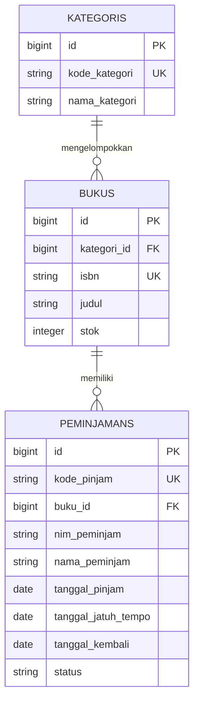

## Pengujian dan Pemeriksaan Gaya

Jalankan seluruh tes:

```powershell
php artisan test
```

Tes mencakup CRUD katalog, jumlah peminjaman dan seluruh statistik, penyimpanan
pencarian dan transaksi terakhir di Session, stok kosong, rollback ketika
penyimpanan transaksi gagal, penolakan pinjaman aktif duplikat, pencatatan
`QueryException`, pengembalian ganda, autentikasi, proteksi rute, serta flag
HttpOnly/SameSite pada cookie.

Pemeriksaan format PHP:

```powershell
vendor/bin/pint --test
```

## Lampiran Bukti Visual

Tampilan berikut berasal dari aplikasi lokal yang sudah dijalankan dengan
seeder. Screenshot penolakan stok nol memperlihatkan pilihan stok 0 yang
dinonaktifkan; validasi sisi server untuk permintaan peminjaman stok 0 juga
dicakup oleh tes `PeminjamanServiceTest`.

### Katalog dan Statistik


### Form dan Riwayat Peminjaman


### Peminjaman Berhasil


### Penolakan Buku dengan Stok Nol


### Pengembalian Buku


### Pemeriksaan Cookie


Cookie `last_peminjaman` terlihat memiliki flag `HttpOnly` dan `SameSite=Lax`.
Nilai cookie pada screenshot disamarkan agar tidak membocorkan token sesi atau
transaksi. Tes otomatis `PeminjamanServiceTest` juga memverifikasi atribut
cookie tersebut.

## Minggu 9 — SOAP dan REST API SIPUS-Del

Implementasi Minggu 9 mempertahankan antarmuka Blade dan menambahkan dua
antarmuka layanan:

- **SOAP Provider:** `GET /soap/sipus.wsdl` menyediakan kontrak WSDL ringkas
  untuk `CheckClearanceStatus`; `POST /soap/sipus` menerima XML SOAP dan
  menghitung pinjaman aktif berdasarkan NIM untuk kebutuhan bebas pustaka.
- **REST Provider:** `/api/v1/bukus` menyediakan katalog, detail, mutasi, dan
  relasi HATEOAS; endpoint transaksi `/api/v1/peminjamans` memakai kembali
  `PeminjamanService` dengan transaksi database dan `lockForUpdate()`.
- **REST Consumer:** detail referensi melalui
  `GET /api/v1/bukus/{id}/referensi-eksternal` memanggil Open Library dengan
  batas waktu 8 detik dan merespons 404/502 saat metadata tidak tersedia.

### Analisis kebutuhan dan kelayakan layanan

SIPUS-Del berperan sebagai **Service Provider** untuk katalog, status
peminjaman, dan pemeriksaan bebas pustaka karena seluruh data tersebut berada
di domain perpustakaan. SIPUS-Del berperan sebagai **Service Consumer** ketika
mengambil metadata ISBN dari Open Library; katalog eksternal tidak perlu
disalin atau dipelihara sendiri.

REST/JSON layak untuk aplikasi Mobile dan Kiosk karena protokol HTTP, URI
resource, status code, serta payload JSON didukung langsung oleh platform
mobile; setiap request membawa bearer token sehingga tidak membutuhkan session
server dan bisa dilayani oleh beberapa instance aplikasi. Operasi katalog
bersifat baca dan dapat dipaginasi, sedangkan peminjaman/pengembalian tetap
menjalankan transaksi ACID di provider. SOAP tetap disediakan secara terbatas
untuk integrasi yudisium legacy yang membutuhkan kontrak WSDL dan XML yang
stabil. Untuk konsumsi metadata, Open Library dipilih dibanding membangun
database metadata eksternal sendiri; pemanggilan dibatasi 8 detik dan
kegagalan upstream dikembalikan eksplisit sebagai 404 atau 502. Dengan lingkup
ini, manfaat interoperabilitas sepadan dengan biaya implementasi dan
pemeliharaan; ketersediaan layanan eksternal tetap menjadi dependensi yang
ditangani sebagai kegagalan terpisah.

| Peran | Sistem yang terlibat | Alasan |
| --- | --- | --- |
| Provider REST | SIPUS-Del → aplikasi Mobile/Kiosk | SIPUS-Del menguasai katalog serta proses sirkulasi; API memberikan data dan transaksi tanpa mengirim HTML Blade. |
| Provider SOAP | SIPUS-Del → sistem Administrasi Yudisium legacy | XML dan kontrak WSDL mendukung kebutuhan integrasi sistem legacy untuk pemeriksaan bebas pustaka. |
| Consumer REST | SIPUS-Del → Open Library | SIPUS-Del mengambil metadata ISBN yang dikelola layanan eksternal, bukan menggandakan sumber data. |

| Aspek | SOAP untuk bebas pustaka | REST untuk Mobile/Kiosk |
| --- | --- | --- |
| Format | XML dengan Envelope dan kontrak WSDL | JSON dengan resource dan HTTP verbs |
| Integrasi | Cocok untuk sistem yudisium legacy | Lebih ringan dan didukung langsung oleh aplikasi mobile |
| Identitas | Endpoint simulasi untuk integrasi legacy | Bearer token Sanctum; setiap request membawa token |
| Respons | XML berisi jumlah pinjaman dan status bebas pustaka | Status HTTP semantik, JSON resource, pagination, dan HATEOAS |

### Katalog endpoint layanan

Semua endpoint REST menggunakan prefix `/api/v1`. Bearer Token berarti header
`Authorization` berisi token hasil login. Endpoint mutasi dan seluruh endpoint
peminjaman dilindungi `auth:sanctum`.

| Method | URI | Proteksi | Deskripsi | Status respons utama |
| --- | --- | --- | --- | --- |
| GET | `/soap/sipus.wsdl` | Publik | Kontrak WSDL `CheckClearanceStatus` | 200 |
| POST | `/soap/sipus` | Publik | Menghitung pinjaman aktif berdasarkan NIM | 200; 500 SOAP Fault |
| POST | `/api/v1/auth/login` | Publik | Memverifikasi akun dan menerbitkan token | 200; 401; 422 |
| GET | `/api/v1/auth/me` | Bearer Token | Profil pemilik token aktif | 200; 401 |
| POST | `/api/v1/auth/logout` | Bearer Token | Mencabut token aktif | 200; 401 |
| GET | `/api/v1/bukus` | Publik | Katalog, pencarian, filter, sorting, dan pagination | 200 |
| GET | `/api/v1/bukus/{id}` | Publik | Detail buku, kategori, dan riwayat | 200; 404 |
| POST | `/api/v1/bukus` | Bearer Token | Membuat buku | 201 + `Location`; 401; 422 |
| PUT | `/api/v1/bukus/{id}` | Bearer Token | Mengganti seluruh representasi buku | 200; 401; 404; 422 |
| PATCH | `/api/v1/bukus/{id}` | Bearer Token | Mengubah sebagian atribut buku | 200; 400; 401; 404; 422 |
| DELETE | `/api/v1/bukus/{id}` | Bearer Token | Menghapus buku tanpa pinjaman aktif | 204; 401; 404; 409 |
| GET | `/api/v1/bukus/{id}/referensi-eksternal` | Publik | Mengambil metadata ISBN dari Open Library | 200; 404; 502 |
| GET | `/api/v1/peminjamans` | Bearer Token | Riwayat dengan filter status/NIM dan pagination | 200; 401; 422 |
| POST | `/api/v1/peminjamans` | Bearer Token | Meminjam buku dan mengurangi stok secara atomik | 201 + `Location`; 401; 409; 422 |
| PATCH | `/api/v1/peminjamans/{id}/kembalikan` | Bearer Token | Mengembalikan buku dan menambah stok secara atomik | 200; 401; 404; 409 |

### Setup dan menjalankan

Versi Laravel mengikuti proyek Minggu 6 yang sudah tersedia di repository
(Laravel 13); tidak dilakukan downgrade dependensi hanya untuk menyesuaikan
nomor versi yang disebut pada modul. Perintah ini mempertahankan data lokal:

```powershell
composer install
php artisan migrate
php artisan db:seed
php artisan serve
```

Jika ingin menyiapkan database pengembangan dari kondisi kosong, gunakan
perintah di bawah **hanya setelah memastikan database aman untuk dihapus**:

```powershell
php artisan migrate:fresh --seed
```

`php artisan install:api` telah mengaktifkan `routes/api.php`, Sanctum, dan
tabel token. Akun pengujian lokal dari seeder adalah
`pustakawan@del.ac.id` / `password123`; jangan gunakan kata sandi contoh pada
lingkungan produksi. Semua endpoint mutasi dan data transaksi membutuhkan
header `Authorization: Bearer <access_token>` dari `POST /api/v1/auth/login`.

### Kontrak dan pengujian

- Kontrak layanan: [`docs/openapi-sipus-v1.yaml`](./docs/openapi-sipus-v1.yaml)
- Koleksi Postman: [`docs/SIPUS-Del-APIv1.postman_collection.json`](./docs/SIPUS-Del-APIv1.postman_collection.json)
- Jalankan tes otomatis: `php artisan test`
- Periksa format PHP: `vendor/bin/pint --test`

Untuk Postman, pilih **Import → File**, lalu impor
`docs/SIPUS-Del-APIv1.postman_collection.json`. Pastikan `app_url` mengarah ke
server lokal. Jalankan **Login petugas** terlebih dahulu agar variabel token
terisi, lalu jalankan skenario lain. Gunakan kategori/buku yang memang ada
setelah seeding; perbarui variabel `kategori_id`, `buku_id`, dan
`peminjaman_id` sesuai data hasil uji.

Koleksi Postman menyimpan token dalam variabel koleksi lokal yang diisi saat
login. Jangan mengekspor token nyata atau memasukkannya ke file yang di-commit.
Permintaan latihan GitHub PATCH memakai variabel `github_token` kosong; isi
hanya pada environment lokal Postman, lalu revoke token setelah latihan.

### Matriks bukti uji Postman untuk laporan

Simpan screenshot hasil uji nyata ke `docs/screenshots/` dan tambahkan tautannya
di tabel ini setelah menjalankan aplikasi. Jangan mengarang screenshot atau
menampilkan bearer token, kredensial, maupun data pribadi.

| Bukti yang diminta | Skenario | Nama berkas yang disarankan |
| --- | --- | --- |
| SOAP XML dan Fault | Respons `CheckClearanceStatus` dan XML cacat tersimpan di bawah | `api-soap-clearance.png`, `api-soap-fault.png` |
| Login Sanctum | `POST /auth/login` berhasil; baris token ditutupi pada screenshot di bawah | `api-login-token-redacted.png` |
| Katalog terfilter | `GET` berhasil dan metadata pagination tampil; filter tidak menemukan buku | `api-katalog-pagination.png` |
| Katalog dengan data | `GET` berhasil dan menampilkan buku; contoh buku pada screenshot memiliki stok 0 | `api-katalog-buku.png` |
| Logout Sanctum | `POST /auth/logout` berhasil mencabut token aktif | `api-logout-revoke.png` |
| HATEOAS | Katalog menampilkan `_links.pinjam_buku` untuk buku dengan stok 2 | `api-katalog-hateoas.png` |
| Buku baru | `POST /bukus` berhasil dengan `201 Created` dan header `Location: /api/v1/bukus/43` | `api-buku-created-location.png` |
| PUT dibanding PATCH | PATCH stok saja dan PUT representasi penuh berhasil; screenshot terpisah | `api-buku-patch.png`, `api-buku-put.png` |
| Peminjaman berhasil | `POST /peminjamans` menghasilkan `201 Created` dan link pengembalian | `api-peminjaman-201.png` |
| Konflik peminjaman | Peminjaman duplikat menghasilkan `409 Conflict` | `api-peminjaman-409.png` |
| Stok habis dan pengembalian | Buku stok 0 ditolak dengan `422`; pengembalian berhasil dengan `200` | `api-peminjaman-422.png`, `api-peminjaman-return.png` |
| Latihan GitHub REST | GET profil publik berhasil dengan `200 OK`; percobaan awal `403` karena rate limit anonim | `github-api-success.png`, `github-api-rate-limit.png` |

#### Bukti SOAP — CheckClearanceStatus

Request dengan NIM contoh `12S24001` berhasil mengembalikan satu pinjaman
aktif dan status belum bebas pustaka.

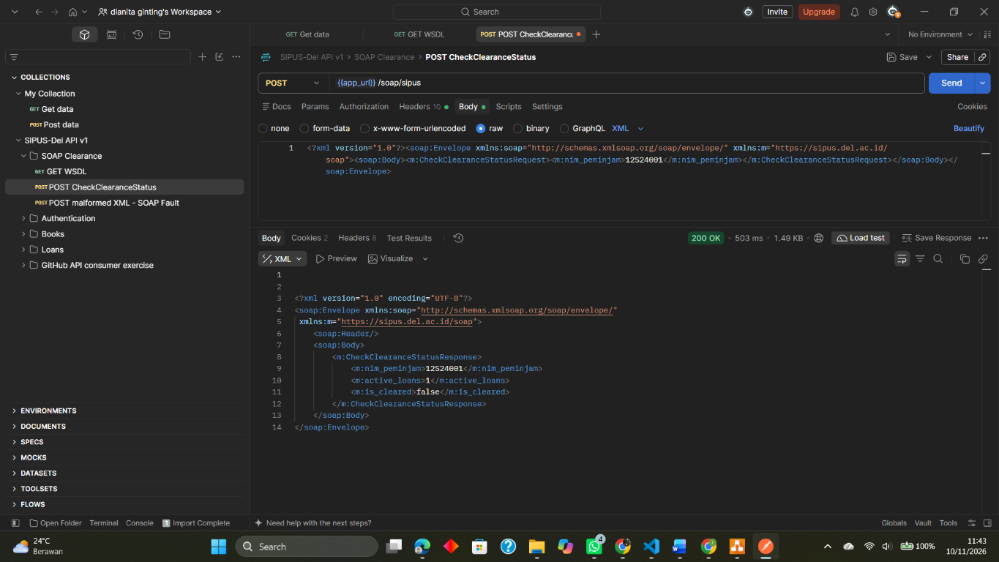

Request dengan XML cacat menghasilkan SOAP Fault seperti yang diharapkan.

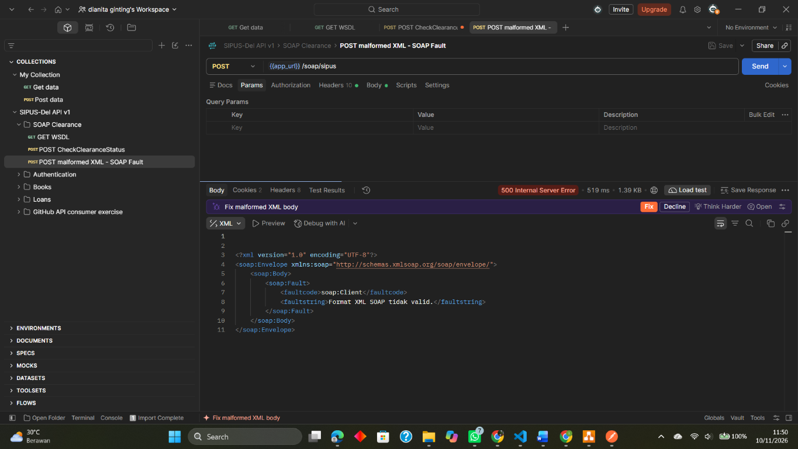

#### Bukti Login API Sanctum

Login berhasil dengan status 200. Baris yang berisi bearer token ditutupi
sebelum screenshot dimasukkan agar token tidak tersebar.

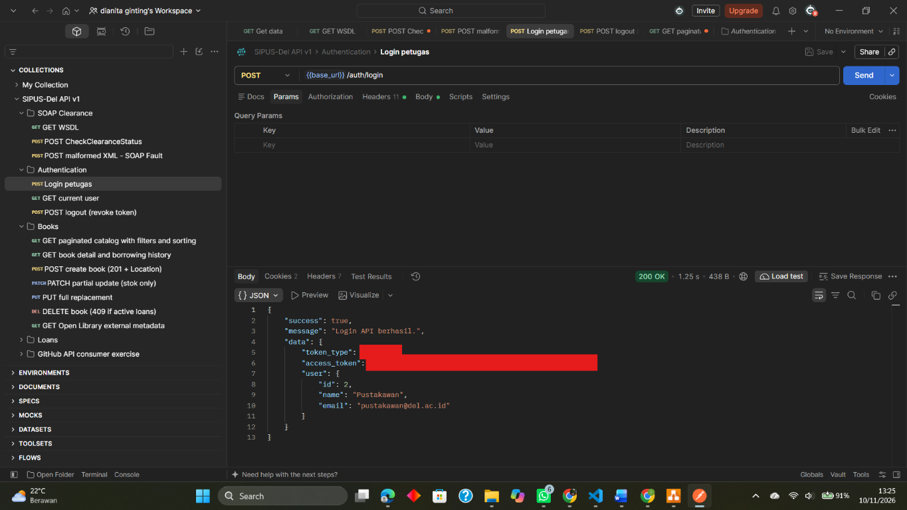

#### Bukti Katalog Terpaginasi

Request katalog dengan filter menghasilkan `200 OK` dan blok `meta` pagination.
Kombinasi filter pada screenshot pertama menghasilkan nol buku. Setelah filter
dihapus, katalog menampilkan buku dengan `200 OK`; contoh yang terlihat
memiliki stok 0 sehingga bukti ini belum menunjukkan link `pinjam_buku`.

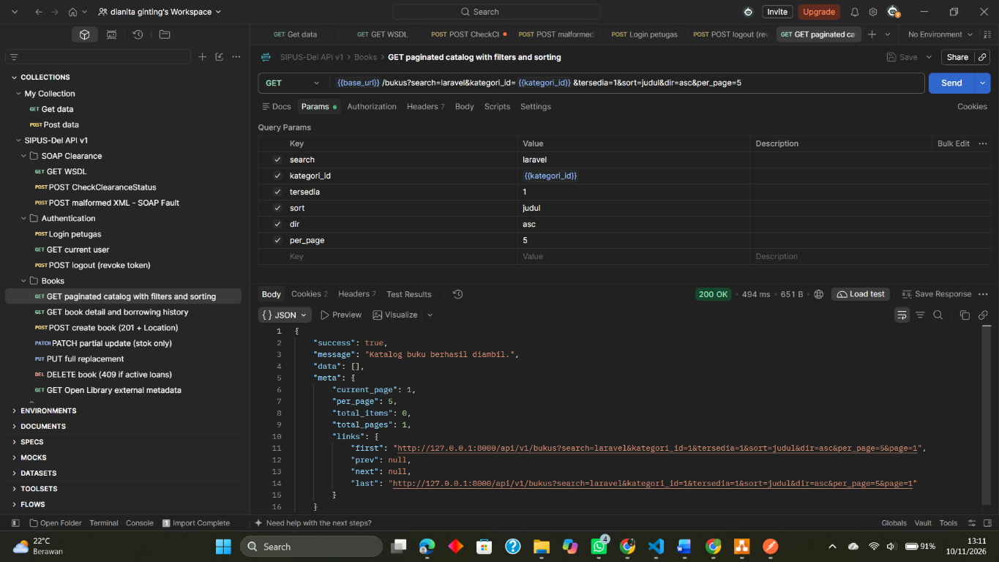

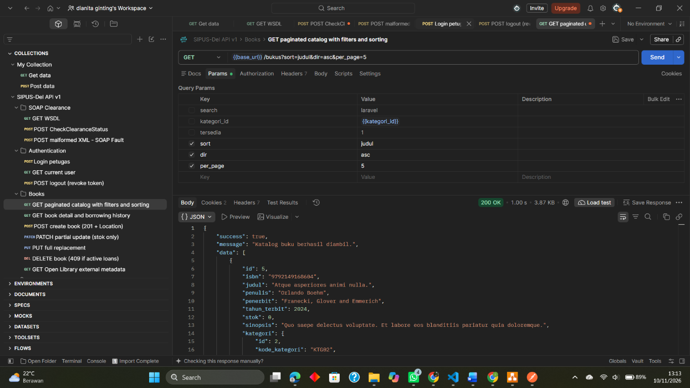

Katalog dengan stok tersedia menunjukkan link HATEOAS `pinjam_buku`.

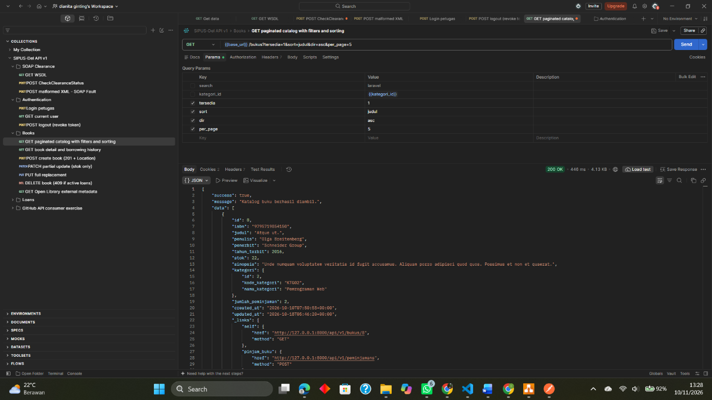

#### Bukti Pembuatan Buku

Pembuatan buku berhasil dengan status `201 Created` (ID buku pada respons: 43).
Header respons menunjukkan `Location: http://127.0.0.1:8000/api/v1/bukus/43`.

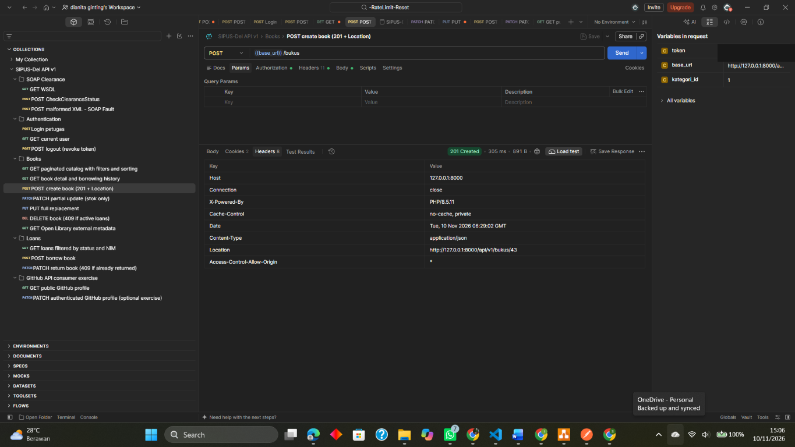

#### Bukti PATCH dan PUT

PATCH berhasil mengubah stok saja (dari 3 menjadi 8), sedangkan PUT berhasil
mengirim representasi penuh buku (stok menjadi 5).

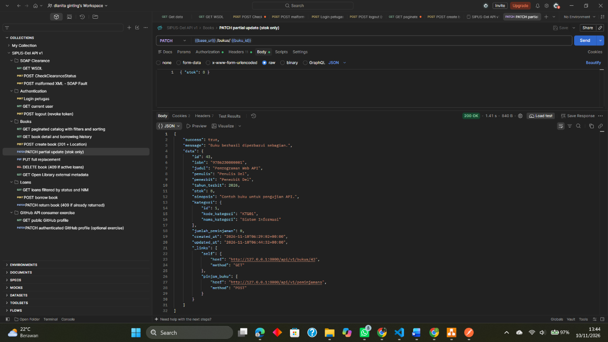

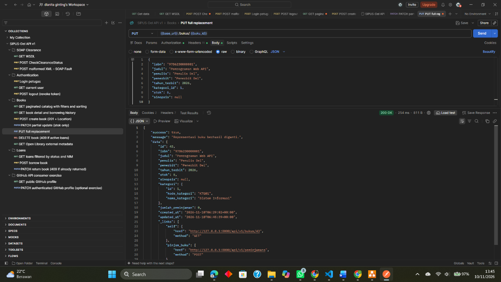

#### Bukti Transaksi Peminjaman

Peminjaman buku berhasil dengan `201 Created` (ID peminjaman 9) dan resource
menampilkan link `kembalikan_buku`. Percobaan meminjam buku yang sama lagi
untuk NIM yang sama ditolak dengan `409 Conflict`.

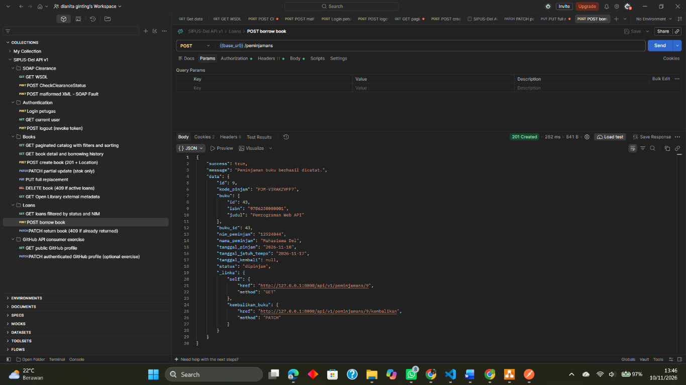

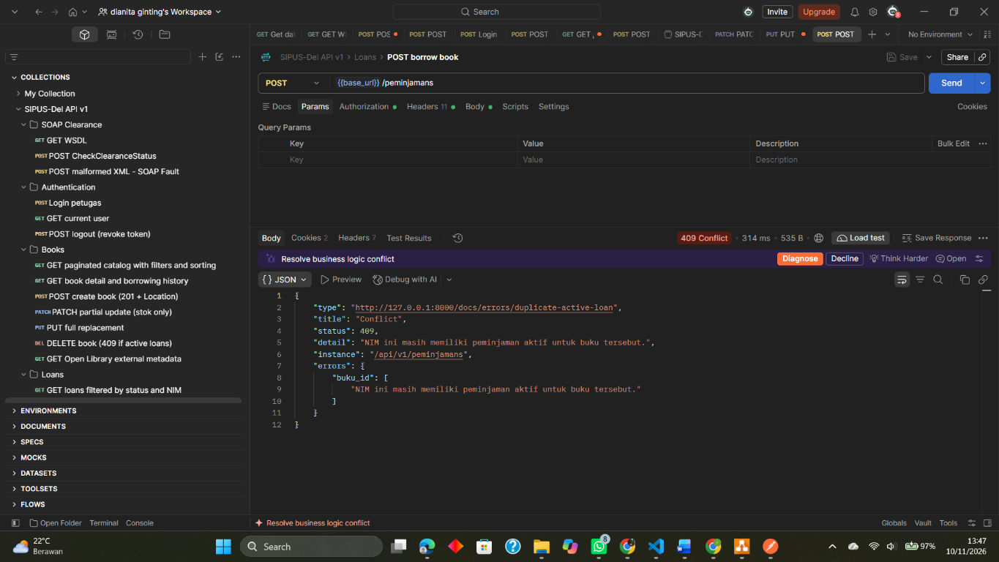

Pengembalian peminjaman ID 9 berhasil dengan `200 OK`. Request peminjaman
untuk buku ID 5 yang stoknya habis ditolak dengan `422 Unprocessable Content`.
Nilai token yang sempat terlihat pada panel Postman ditutupi pada kedua bukti.

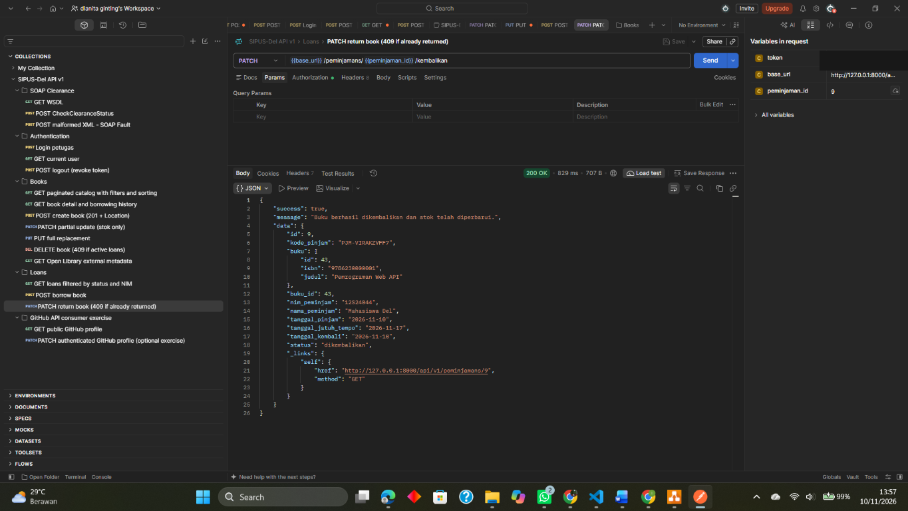

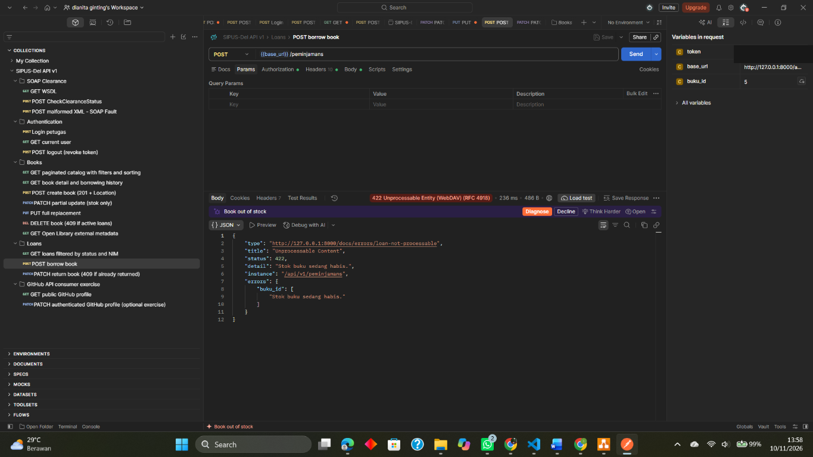

#### Bukti Logout Sanctum

Logout berhasil dengan `200 OK` dan pesan token API berhasil dicabut.

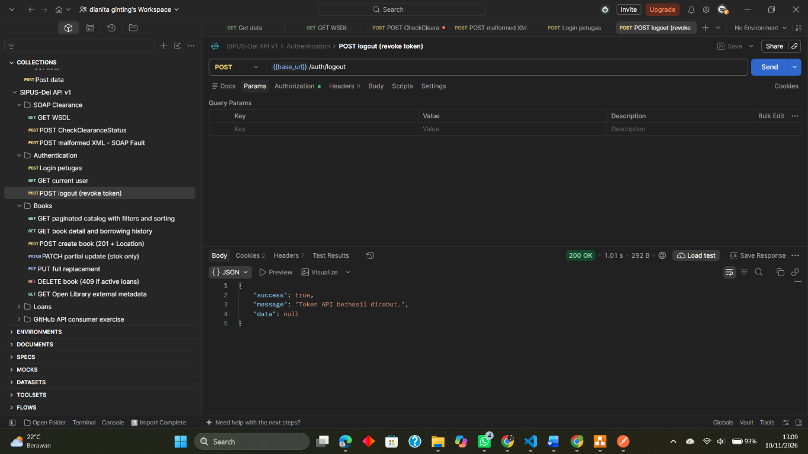

#### Bukti GitHub REST API

Setelah rate limit anonim ter-reset, request GET profil publik `octocat`
berhasil dengan `200 OK`. Request ini tidak memakai token.

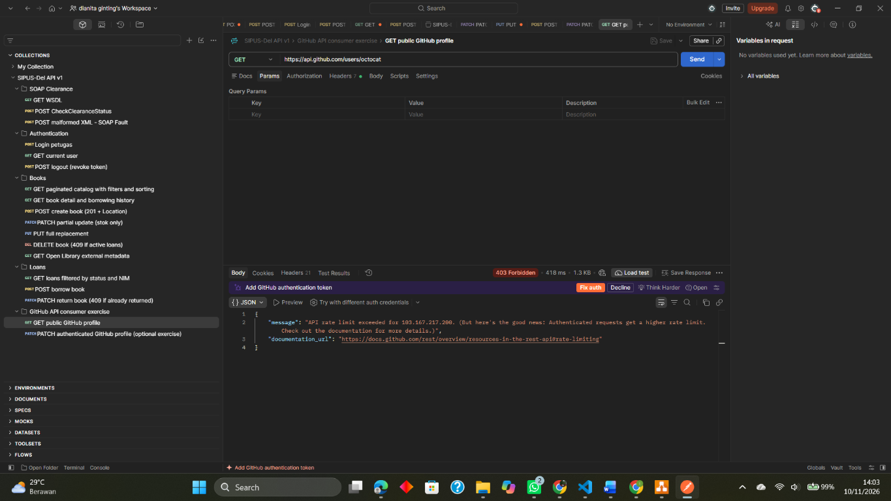

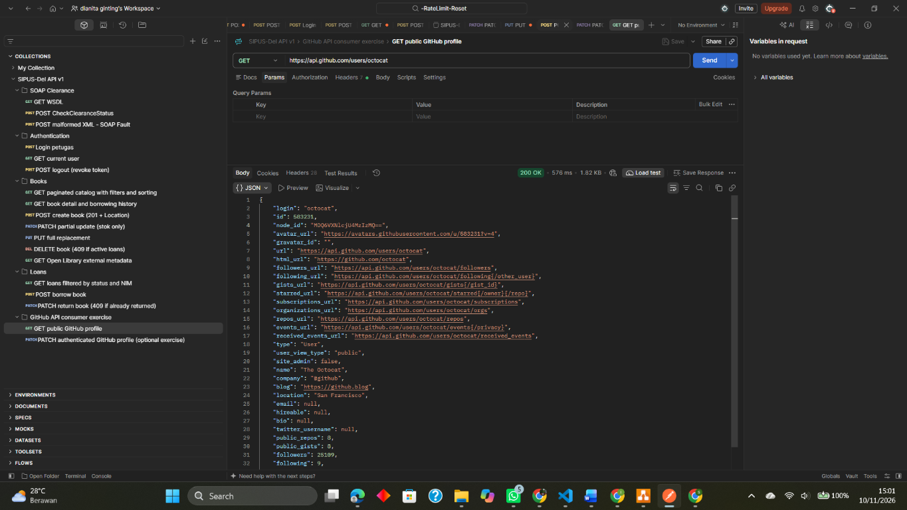

Tes otomatis API tersedia di `tests/Feature/RestApiTest.php`; tes tersebut
mencakup validasi, status semantik, HATEOAS, pembatalan token, SOAP Fault,
transaksi sirkulasi, serta Open Library dengan HTTP fake agar tidak bergantung
pada jaringan.
